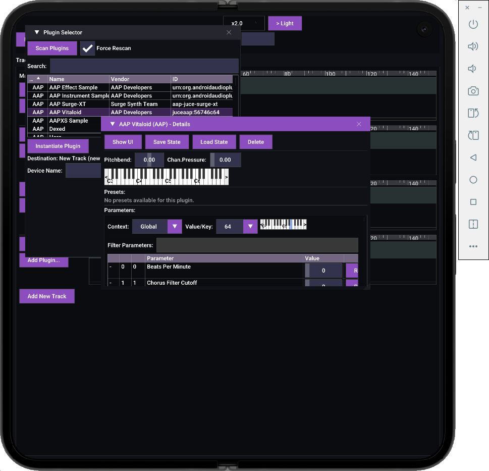

## AAP audio buses

remidy uses aap-core's buses API to expose the plugin's main and auxiliary audio
buses, including sidechains, multiple outputs, channel layouts, and enabled states.
Use an aap-core SDK and published native library that include `aap/ext/buses.h`
and the bus buffer accessors. Legacy plugins use the buses derived by aap-core
from their ports or category defaults.

Main input/output channel requests are negotiated with plugins that support
layout changes; fixed-layout plugins keep their actual channel counts. Bus
layouts are refreshed during `configure()`, while processing is stopped, and
plugin-initiated changes take effect on the next configuration. Unconnected or
host-disabled inputs are silenced, and all connected output buses are copied.

## AAP ARA support

Android ARA support uses the ARA SDK through the ARAAAP companion integration in
[aap-ara](https://github.com/atsushieno/aap-ara), alongside aap-core 0.12.0.
Check out the repositories at `android/external/aap-core` and
`android/external/aap-ara`, then publish their libraries before building UAPMD:

```sh
cd external/aap-core
./gradlew publishToMavenLocal
cd ../aap-ara
git submodule update --init --recursive
./gradlew :androidaudioplugin-ara:publishToMavenLocal
cd ../..
./gradlew assembleDebug
```

For an existing aap-core checkout elsewhere, pass `-PaapDir=/absolute/path/to/aap-core`
to the UAPMD Gradle build. The Android Actions workflow accepts `aap_core_ref`
and `aap_ara_ref` and checks out and publishes both dependencies automatically.
Use an aap-ara revision containing the SDK-backed `/ara/v2` transport, and install
a plug-in built against that integration. The older `/ara/v1` custom document
protocol is incompatible. Rebuild UAPMD after publishing an updated local AAR;
updating only the plug-in APK leaves the host on its previous protocol.

With the ARA support addin enabled, adding an AAP ARA plugin attaches the existing
plugin instance to the project. Audio clips, track sequences, clip moves, source
changes, and removal reach its document model; its usual plugin UI shows that same
document. It uses the same SDK document controller and project projection as the
desktop formats, with ARAAAP proxies for the factory, controller, and renderer/view
roles. Property sizes advertise the fields actually supplied, and clip regions
retain their source offsets and trimmed lengths. Clips sharing a file resolve
the same SDK source; full document refreshes preserve existing modifications.
Document synchronization and source access work with the audio engine off;
enable it for playback. Source reads use independent file readers. SDK model
notifications invalidate rendered tracks when polled on the host event loop.
SDK document and filtered object archives are included in project save/load and
clip/track clipboard state, including persistent-ID remapping on paste.
Archives saved by the former AAP backend are unpacked and restored through the
SDK plug-in reader; subsequent saves use the plug-in's SDK archive identifier.

Selection changes also reach visible SDK editor views. Clips and tracks map to playback regions and
region sequences, with an optional explicit project-time range. Opening/reopening
the editor sends the current selection; document edits refresh its projection.
Selection does not change document revisions, dirty state or undo history.

Tempo, meter, tuning, and note content readers, plug-in analysis requests, and
content reads use the SDK interfaces, subject to the plug-in's advertised content
types. Timeline arrangement stays host-owned, and audible ARA rendering depends
on the plug-in's AAP processing support.

Verified on 2026-10-20: the Android APK builds for arm64-v8a and x86_64, and the
desktop ARA library builds. With the audio engine disabled, the Galaxy SM-X230
loads the previous AAP project archive, displays both clips sharing one source,
preserves its 0.51× gain through SDK save/reload, and forwards host clip selection.
The trimmed clip retains its 0.5-second source offset and 2-second duration.

## Working-session recovery

The Android app saves a private `android-session.uapmdz` in its files directory
when SDL reports `SDL_EVENT_WILL_ENTER_BACKGROUND`, and also on normal exit.
The lifecycle watcher runs on the model thread before SDL suspends it, draining
queued plugin-state callbacks for up to three seconds. A plugin that takes longer
can finish its pending save on resume; until then, the previous snapshot remains.
The archive includes copied media, empty tracks, plugin states, and project
extensions. It is committed by renaming a completed temporary archive, so a failed
or interrupted write leaves the previous recovery snapshot intact.

Startup restores the snapshot before enabling audio. An ordinary resume keeps the
live project. Recovery saves leave the user's saved-history state unchanged;
restored projects are marked unsaved. A failed restore is logged and its snapshot
is preserved until an explicit New/Open succeeds. Undo history and editor window
state are not part of the project archive.

To check on a device, create an unsaved project with MIDI, audio, and a plugin;
background and resume it, then background it again, kill the background process,
and relaunch. Check the clips, mixer/plugin state, and empty tracks, including
media originally loaded from an archive. Repeat after New/Open to ensure recovery
uses the current project. Logcat reports session save and restore outcomes.
